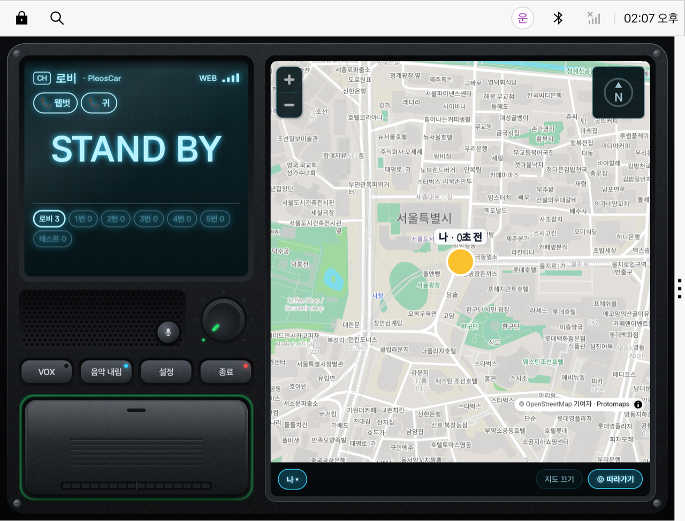

# onPTT (온서포터 무전) — Pleos Connect 앱

여러 대의 차량을 하나의 채널로 묶어, 음성 무전과 위치·목적지·도착 예정 시간·배터리 잔량을
실시간으로 나누는 차량용 그룹 무전 앱입니다.

현대자동차그룹 차량용 앱 개발 공모전 출품작이며, 심사를 위해 앱 소스를 공개합니다.



- 앱 파일: [`apk/onptt-car-1.6.7.apk`](apk/onptt-car-1.6.7.apk) (Pleos Connect), [`apk/onptt-phone-1.6.7.apk`](apk/onptt-phone-1.6.7.apk) (스마트폰), 지문은 [`apk/SHA256SUMS.txt`](apk/SHA256SUMS.txt)
  — 이 저장소 소스를 그대로 빌드하면 같은 지문의 파일이 나옵니다(운영에서 내려받는 1.6.7 과 같은 파일).
- 웹 버전(설치 없이 참여): https://onsupporter.com/ptt
- 사용 설명서: https://onsupporter.com/ptt/manual

## 주요 기능

| 기능 | 내용 |
|---|---|
| 그룹 무전(PTT) | 누르고 말하면 같은 채널 전원에게 바로 전달. 1:1 무전도 지원. WebRTC(UDP) 전송 |
| 공개방·개인방 | 닉네임만으로 공개방에 입장. 일행은 개인방으로 부르고, 부름은 버튼이나 음성으로 수락 |
| 일행 위치 지도 | 같은 채널 참가자의 위치와 거리를 지도에 표시 |
| 목적지 공유 | 내비게이션 안내 중이면 목적지·남은 시간·남은 거리를 일행에게 공유 |
| 원터치 경로 안내 | 일행의 위치 또는 같은 목적지로 차량 내비게이션 안내 시작 |
| 배터리·주행 가능 거리 | 일행의 배터리(연료) 잔량과 주행 가능 거리 공유 |
| 사고 감지 알림 | 에어백 전개 시 같은 채널에 사고 알림과 위치 전송 |
| 음악 내림 | 무전을 받거나 말하는 동안 차량 음악을 낮췄다가 되돌림 |

## 차량 특화 요소

- **음성 명령(STT)** — 스피커 그릴의 마이크 단추 또는 핸들 키로 시작합니다.
  「1번 채널」 「앞차 길 안내」 「같은 곳」 「사고 자리」 「입장코드 일이삼 사오육」 「(이름) 길 안내」 「(이름) 같은 곳」 「들어가기 / 거절」
- **음성 안내(TTS)** — 명령 결과, 1:1 요청, 개인방 부름, 일행 도착 임박, 주행 가능 거리 부족을 말로 알립니다.
- **핸들 키** — 무전 화면이 앞에 있을 때 탐색 ∨ 는 누르는 동안 송신, ∧ 는 음성 명령.
  내비가 앞에 있거나 무전에 붙어 있지 않으면 원래대로 곡 넘기기입니다.
- **기어 연동** — 주행 중(P 단 외)에는 글자 입력을 막고, P 단 정차 시 주정차 단속 구간을 알립니다.
- **차량 위치** — 차량 융합 위치(FusedLocation)를 쓰고, 끊기면 내비게이션 위치로 대체합니다.

## Pleos SDK 사용 위치

모두 [`app/src/car/java/com/onsupporter/ptt/Pleos.kt`](app/src/car/java/com/onsupporter/ptt/Pleos.kt) 한 곳에 모았습니다.
SDK 가 없거나 권한이 없어도 무전은 그대로 동작하도록, 부를 때마다 실패를 받아 넘깁니다.

| SDK | 쓰는 것 |
|---|---|
| Vehicle | 기어(`GearSelectionListener`), 배터리 잔량·연료·주행 가능 거리, 에어백 전개(`SeatAirbagDeployedListener`) |
| NaviHelper | 현재 위치, 목적지·남은 시간·거리(`getDestinationInfo`, `getRouteStateInfo`), 경로 안내 요청(`requestRoute`) |
| FusedLocation | 차량 융합 위치 |
| SpeechToText | 음성 명령 받아쓰기(기기 내 처리) |
| TextToSpeech | 음성 안내(기기 내 처리) |

## 소스 구성

하나의 무전 엔진을 스마트폰 앱과 차량 앱이 같이 씁니다. 화면만 갈래(flavor)로 나뉩니다.

```
app/src/main   공통 - 서버 연결(Link), WebRTC(Rtc), 마이크·스피커(Voice), 음악 내림(Duck),
               무전 서비스(PttService), 음성 명령 풀이(Command), 무전기 앞판 그리기(Hw)
app/src/car    Pleos Connect 화면(MainActivity)과 Pleos SDK(Pleos)
app/src/phone  스마트폰 화면, 스마트폰 받아쓰기·읽어 주기(Ear)
```

무전 서버(음성 중계·채널·위치)는 운영 서비스(onsupporter.com)이며 이 저장소에는 넣지 않았습니다.
앱은 빌드한 그대로 운영 서버에 붙습니다.

## 빌드와 실행

필요한 것: JDK 17, Android SDK(compileSdk 36). Pleos SDK 는 로그인 없이 Pleos 메이븐 저장소에서 받습니다.

```bash
./gradlew assembleCarDebug      # Pleos Connect 앱
./gradlew assemblePhoneDebug    # 스마트폰 앱
```

Pleos Connect 에뮬레이터(v2.1.0)에 설치:

```bash
adb install --user 10 apk/onptt-car-1.6.7.apk   # 또는 직접 빌드한 app/build/outputs/apk/car/debug/app-car-debug.apk
```

- 에뮬레이터는 사용자 10(운전자)으로 실행되므로 `--user 10` 이 필요합니다.
- 마이크를 쓰려면 에뮬레이터를 `-allow-host-audio` 로 띄웁니다.
- 처음 실행하면 닉네임을 넣고 「접속」 을 누릅니다. 같은 채널에 웹(https://onsupporter.com/ptt)으로 한 명 더 들어오면 바로 무전을 주고받을 수 있습니다.

## 저작권

Copyright © 2026 온서포터. 공모전 심사를 위해 공개한 소스입니다. 별도 허락 없이 재배포하거나 상업적으로 쓸 수 없습니다.
